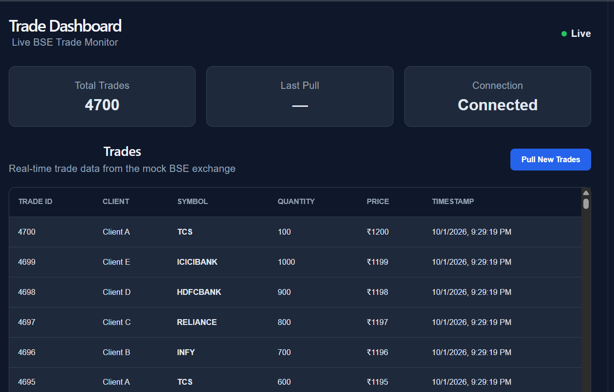
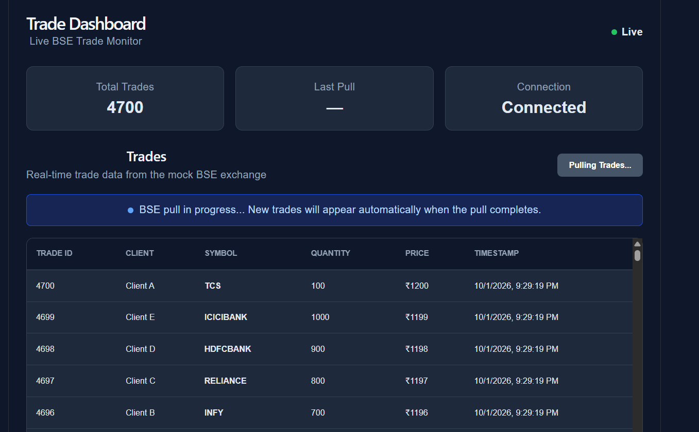
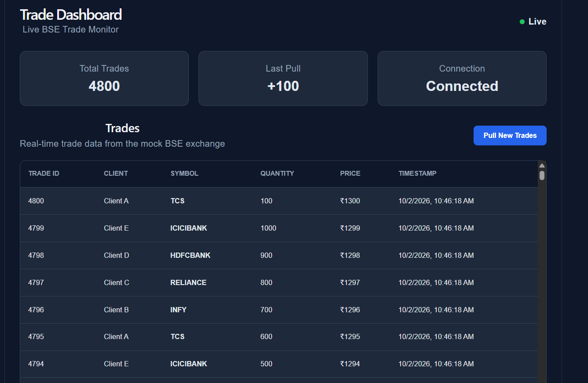
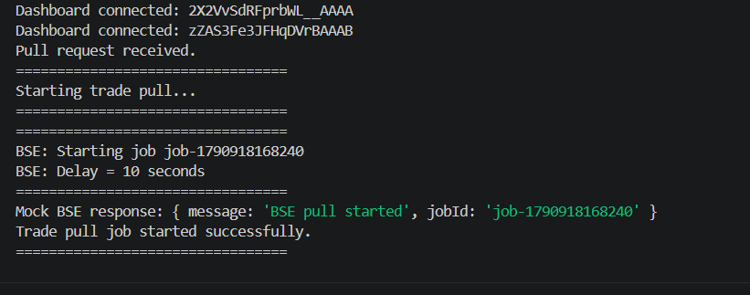
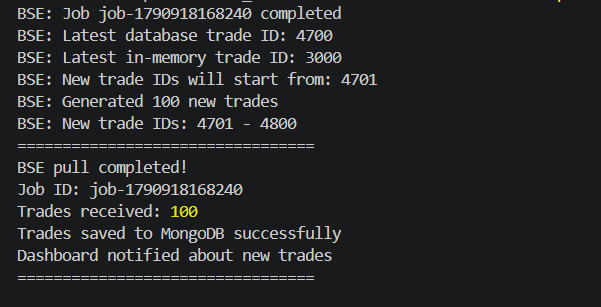

# Trade Dashboard

A full-stack trade dashboard that demonstrates asynchronous trade processing when an HTTP connection is limited to 30 seconds. Long-running pulls are handled in the background, saved to MongoDB, and reflected in the dashboard in real time without polling or refreshing the page.

## Live Demo

- **Frontend:** https://main.donam7mule81u.amplifyapp.com
- **Backend API:** https://trade-dashboard-arpit.duckdns.org

## Features

- Displays persisted trades from MongoDB.
- Starts long-running trade pulls asynchronously.
- Uses a Mock BSE API to simulate trade data and background processing.
- Saves completed trades with MongoDB bulk operations and upserts.
- Uses Socket.IO to notify the dashboard when new trades are available.
- Avoids long-lived HTTP requests, browser refreshes, polling, and scheduler jobs.

## Architecture

```text
                         React Dashboard
                    (Existing Trades / Pull New)
                                |
                         HTTP + Socket.IO
                                |
                                v
                      Node.js + Express Backend
                    /trades | /pullTrades | /bse-callback
                         /             \\
                        /               \\ Socket.IO:
              Start pull request         \\ tradesUpdated
                      |                   \\
                      v                    v
                  Mock BSE API          React Dashboard
               /getTrades | /startPull       |
                      |                      | GET /trades
               Background job                |
                      |                      |
               Generate new trades           |
                      |                      |
               POST /bse-callback             |
                      |                      |
                      v                      |
                 Backend persists trades     |
                      |                      |
                      v                      |
                    MongoDB <----------------+
```

### Asynchronous flow

1. The dashboard sends `POST /pullTrades`.
2. The backend asks the Mock BSE API to start a pull and returns without waiting for it to finish.
3. The Mock BSE API processes the job in the background.
4. When complete, it sends the generated trades to `POST /bse-callback`.
5. The backend persists the trades in MongoDB.
6. The backend emits the Socket.IO event `tradesUpdated`.
7. The dashboard fetches `GET /trades` and displays the updated data.

The initial HTTP request does not stay open for the full pull duration. MongoDB remains the persisted source of truth, while Socket.IO provides real-time notifications.

## Screenshots

### Trade Dashboard

The dashboard displays persisted trades and remains usable while a new pull is in progress.



### Asynchronous Trade Pull

The dashboard remains responsive while the Mock BSE API processes the pull.



### Automatic Real-Time Update

Newly persisted trades appear automatically without a page refresh or polling.



### Backend Processing

The backend logs show the asynchronous job and callback flow.





## Tech Stack

- **Frontend:** React, Vite, JavaScript, CSS, Socket.IO Client
- **Backend:** Node.js, Express, Socket.IO, Mongoose
- **Database:** MongoDB Atlas
- **Deployment:** AWS Amplify, AWS EC2, Nginx, PM2
- **HTTPS:** DuckDNS and Let's Encrypt

## API Endpoints

| Method | Endpoint | Description |
|---|---|---|
| `GET` | `/trades` | Returns trades persisted in MongoDB. |
| `POST` | `/pullTrades` | Starts an asynchronous trade pull. |
| `POST` | `/bse-callback` | Internal callback used by the Mock BSE API to submit completed trades. |
| `GET` | `/getTrades` | Mock BSE endpoint that returns seeded trade data. |
| `POST` | `/startPull` | Starts a background pull in the Mock BSE API. |

When the callback is processed successfully, the backend emits the Socket.IO event `tradesUpdated`.

## Run Locally

### Prerequisites

- Node.js and npm
- MongoDB, or a MongoDB Atlas connection string

### 1. Clone the repository

```bash
git clone https://github.com/arpitsingh39/trade-dashboard.git
cd trade-dashboard
```

### 2. Install backend dependencies

```bash
cd backend
npm install
```

### 3. Configure environment variables

Create `backend/.env`:

```env
BSE_PULL_DELAY=10
MONGO_URI=your_mongodb_connection_string
```

Keep `.env` private; it should not be committed to Git.

### 4. Start the backend

From the `backend` directory:

```bash
npm run dev
```

The backend runs at `http://localhost:5000`.

### 5. Install and start the frontend

In a separate terminal, from the repository root:

```bash
cd frontend
npm install
npm run dev
```

Open the local URL printed by Vite, usually `http://localhost:5173`.

## Testing the Asynchronous Pull

1. Open the dashboard.
2. Click **Pull New Trades**.
3. Existing trades remain visible while the pull runs.
4. After the configured delay, the Mock BSE API generates 100 new trades.
5. The backend persists the trades and emits `tradesUpdated`.
6. The dashboard refreshes its data automatically without a browser refresh or polling.

To test a pull longer than 30 seconds, set `BSE_PULL_DELAY=40` in `backend/.env` and restart the backend.

## Note

This project uses a Mock BSE API created for the assessment. It does not connect to or claim to reproduce the behavior of the real BSE Exchange API.
