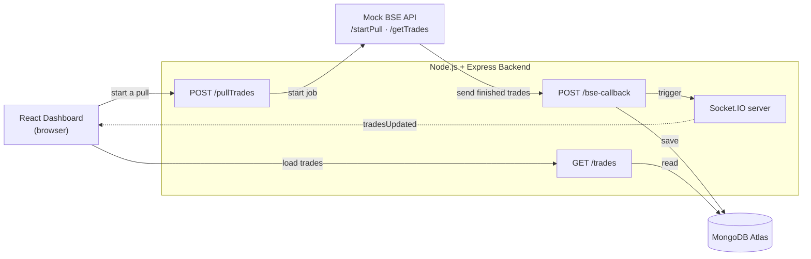
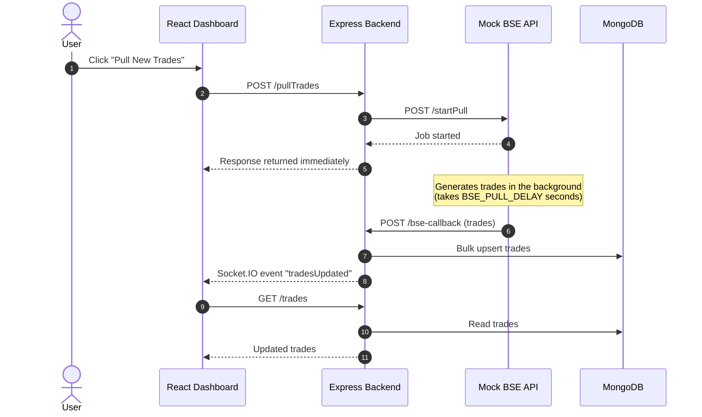

# Trade Dashboard

A full-stack dashboard that shows how to handle **long-running trade pulls** when an HTTP connection is limited to **30 seconds**. The pull runs in the background, the results are saved to MongoDB, and the dashboard updates in real time. No polling, no page refresh, no scheduler jobs.

**Live demo**

| | Link |
|---|---|
| Frontend | https://main.donam7mule81u.amplifyapp.com |
| Backend API | https://trade-dashboard-arpit.duckdns.org |

## Contents

- [The problem](#the-problem)
- [How it works](#how-it-works)
- [Architecture](#architecture)
- [Features](#features)
- [Screenshots](#screenshots)
- [Tech stack](#tech-stack)
- [API endpoints](#api-endpoints)
- [Run locally](#run-locally)
- [Testing the asynchronous pull](#testing-the-asynchronous-pull)
- [Note](#note)

## The problem

Fetching trades from an external source can take longer than the 30-second HTTP limit. If the dashboard waits on a single request, the connection times out and the user sees nothing.

## How it works

Instead of waiting for the pull to finish, the backend **starts the job and returns immediately**. When the job completes, the source **calls the backend back** with the trades, and the backend **pushes a notification** to the browser.

In short:

> **Request → Start job → Return immediately → Callback with results → Save → Notify → Refresh**

## Architecture

### 1. System overview

Who talks to whom:



| Component | Responsibility |
|---|---|
| **React Dashboard** | Shows trades, starts pulls, listens for `tradesUpdated` and re-fetches. |
| **Express Backend** | Starts pulls, receives callbacks, saves trades, serves trade data. |
| **Socket.IO** | Pushes a real-time `tradesUpdated` event to the dashboard. |
| **Mock BSE API** | Simulates a slow trade source that works in the background and calls back when done. |
| **MongoDB Atlas** | Persistent source of truth for all trades. |

### 2. Step-by-step flow

What happens when you click **Pull New Trades**:



1. The dashboard sends `POST /pullTrades`.
2. The backend asks the Mock BSE API to start a pull and **responds right away** without waiting for it to finish.
3. The Mock BSE API generates the trades in the background.
4. When finished, it sends the trades to `POST /bse-callback`.
5. The backend saves them to MongoDB using bulk upserts.
6. The backend emits the Socket.IO event `tradesUpdated`.
7. The dashboard receives the event, calls `GET /trades`, and shows the new data.

### Key design decisions

- **No long-lived requests.** The initial request finishes quickly, so the 30-second limit never applies to the pull itself.
- **Callback instead of polling.** The browser never asks "is it done yet?". The server tells it.
- **MongoDB is the source of truth.** Socket.IO only says *something changed*; the data itself is always read from `GET /trades`.
- **Bulk operations and upserts.** Trades are written in one batch, which is faster than saving them one by one.

## Features

- Displays persisted trades from MongoDB.
- Starts long-running trade pulls asynchronously.
- Simulates a trade source and background processing with a Mock BSE API.
- Saves completed trades using MongoDB bulk operations and upserts.
- Notifies the dashboard in real time through Socket.IO.
- Keeps existing trades visible and the UI responsive while a pull is running.

## Screenshots

### Trade Dashboard

Persisted trades are shown, and the dashboard stays usable while a new pull is in progress.


### Asynchronous trade pull

The dashboard stays responsive while the Mock BSE API processes the pull.


### Automatic real-time update

New trades appear automatically, without a page refresh or polling.


### Backend processing

Backend logs showing the job start, callback, and database update.


## Tech stack

| Layer | Technologies |
|---|---|
| Frontend | React, Vite, JavaScript, CSS, Socket.IO Client |
| Backend | Node.js, Express, Socket.IO, Mongoose |
| Database | MongoDB Atlas |
| Deployment | AWS Amplify (frontend), AWS EC2 + Nginx + PM2 (backend) |
| HTTPS | DuckDNS and Let's Encrypt |

## API endpoints

| Method | Endpoint | Description |
|---|---|---|
| `GET` | `/trades` | Returns the trades persisted in MongoDB. |
| `POST` | `/pullTrades` | Starts an asynchronous trade pull and returns immediately. |
| `POST` | `/bse-callback` | Internal. Used by the Mock BSE API to submit completed trades. Emits `tradesUpdated` on success. |
| `GET` | `/getTrades` | Mock BSE endpoint that returns seeded trade data. |
| `POST` | `/startPull` | Mock BSE endpoint that starts a background pull. |

## Run locally

### Prerequisites

- Node.js and npm
- MongoDB, or a MongoDB Atlas connection string

### 1. Clone the repository

```bash
git clone https://github.com/arpitsingh39/trade-dashboard.git
cd trade-dashboard
```

### 2. Set up the backend

```bash
cd backend
npm install
```

Create `backend/.env`:

```env
BSE_PULL_DELAY=10
MONGO_URI=your_mongodb_connection_string
```

| Variable | Description |
|---|---|
| `BSE_PULL_DELAY` | Seconds the Mock BSE API waits before sending trades back. |
| `MONGO_URI` | MongoDB connection string. |

> Keep `.env` private and make sure it is not committed to Git.

Start the backend:

```bash
npm run dev
```

It runs at `http://localhost:5000`.

### 3. Set up the frontend

In a separate terminal, from the repository root:

```bash
cd frontend
npm install
npm run dev
```

Open the URL printed by Vite, usually `http://localhost:5173`.

## Testing the asynchronous pull

1. Open the dashboard.
2. Click **Pull New Trades**.
3. Existing trades stay visible while the pull runs.
4. After the configured delay, the Mock BSE API generates 100 new trades.
5. The backend saves them and emits `tradesUpdated`.
6. The dashboard updates automatically, with no refresh or polling.

**To test a pull longer than 30 seconds:** set `BSE_PULL_DELAY=40` in `backend/.env` and restart the backend. The initial request still returns immediately, and the update arrives about 40 seconds later.

## Note

This project uses a Mock BSE API created for an assessment. It does not connect to, or claim to reproduce the behavior of, the real BSE Exchange API.
